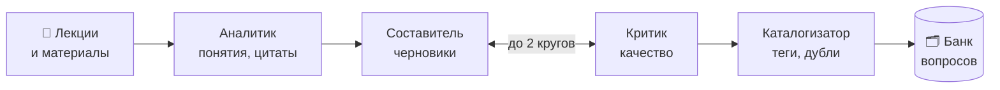
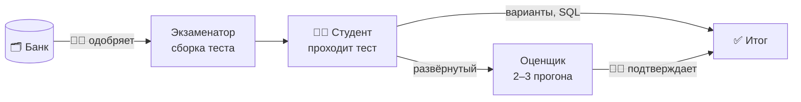

<div align="center">

# 🎓 Мультиагентная система генерации заданий и проверки развёрнутых ответов

**LLM-агенты по учебным материалам составляют банк контрольных вопросов,<br>собирают тесты и предварительно оценивают развёрнутые ответы студентов**

[](https://github.com/Kykylllka01/ptp_diploma/releases/latest)
[](CHANGELOG.md)
[](https://utmn.malanych.ru)

[](https://www.php.net/)
[](https://laravel.com/)
[](https://www.mysql.com/)
[](https://vitejs.dev/)
[](https://www.deepseek.com/)
[](backend/tests/Feature)

Выпускная квалификационная работа · ТюмГУ · «Информационные системы и технологии»

[Что нового](#-что-нового-в-110) · [Возможности](#-возможности) · [Как это работает](#-как-это-работает) · [Агенты](#-агенты) · [Запуск](#-быстрый-старт) · [Версии и выкладка](#-версии-и-выкладка) · [Статус](#-статус-работы)

</div>

---

## 🆕 Что нового в 1.1.0

> Выпуск от 14 октября 2026 · [все изменения версии](CHANGELOG.md#110--2026-10-14) · [страница выпуска на GitHub](https://github.com/Kykylllka01/ptp_diploma/releases/tag/v1.1.0)

- 🗑 **Банк вопросов**: удаление выбранных вопросов пачкой и «Выбрать все» с учётом вкладки, фильтров и поиска.
- 🔐 **Права авторов**: тест и вопрос меняет, а оценку подтверждает только их автор; коллеги видят чужое и могут пройти чужой тест сами.
- 🛡 **Безопасность**: сайт работает только по HTTPS, защитные заголовки, ключ вопроса нельзя поменять после ответов студентов.
- 💸 **Расход на нейросеть** — в админ-панели, в рублях по курсу ЦБ: всего, за 30 дней и по агентам.
- ✨ **Интерфейс**: глазок у паролей, статус теста перед названием в аналитике, метки «Экспериментально» у SQL-заданий и своего варианта каждому студенту.

Предыдущий выпуск — [1.0.0, пилот на 200 студентов](CHANGELOG.md#100--2026-10-14). Полная история — в [**журнале изменений**](CHANGELOG.md).

## 💡 Зачем

Сейчас контроль знаний в вузе устроен так: преподаватель вручную составляет и собирает тест в Moodle, задания годами повторяются, вся группа получает один вариант, а развёрнутые ответы проверяются долго и с разной строгостью. Студент вне аудитории видит только балл и не понимает, за что его получил.

Система берёт рутину на себя и оставляет решения за преподавателем:

| Проблема | Что делает система |
|---|---|
| 🔁 Задания повторяются из года в год | Агенты генерируют новые вопросы по загруженным лекциям |
| ⏳ Составление и сборка теста занимают много времени | Тест собирается из банка по матрице «тип × сложность» в один клик |
| 📋 Один вариант на всю группу | Вопросы и варианты перемешиваются; можно дать каждому студенту свой вариант из пула |
| ✍️ Ручная проверка развёрнутых ответов | Агент-оценщик даёт предварительную оценку по критериям, преподаватель подтверждает |
| ❓ Студент видит только балл | Разбор ответов с пояснениями, апелляция, работа над ошибками |

## ✨ Возможности

<table>
<tr>
<td width="50%" valign="top">

### 👩‍🏫 Преподаватель

- **Загрузка материалов** — PDF, DOCX, PPTX, TXT, ссылка или текст
- **Генерация вопросов агентами** в фоне, с журналом работы агентов
- **Банк вопросов** — фильтры, правка, одобрение и удаление пачкой, «выбрать без замечаний Критика»
- **Шесть типов вопросов** — один верный, несколько верных, верно/неверно, сопоставление, SQL-запрос, развёрнутый ответ
- **Сборка теста** по матрице «тип × сложность», свой вариант каждому студенту
- **Группы** со ссылками-приглашениями для регистрации студентов
- **Жёсткий прокторинг** — уходы со страницы видны в ответах студента
- **Проверка развёрнутых ответов** — оценка агента, подсветка, уверенность, подтверждение
- **Аналитика** курса и теста, **журнал для Модеуса**, экспорт банка в Moodle XML
- **Несколько преподавателей** на курсе: «Мои / Все», менять может только автор

</td>
<td width="50%" valign="top">

### 🧑‍🎓 Студент

- **Регистрация** по ссылке-приглашению своей группы
- **Мои тесты** — тесты своей группы и тренировки
- **Прохождение** с таймером по времени сервера и автосохранением
- **SQL-задания** на учебной базе прямо в браузере
- **Мгновенная оценка** вариантов и SQL, предварительная — развёрнутых ответов
- **Результаты** с разбором и пояснениями, когда пересдавать уже нельзя
- **Апелляция** по развёрнутому ответу
- **Работа над ошибками** — тренировка по неверным ответам

### 🛠 Администратор

- **Ссылки-приглашения** для преподавателей на 1–30 человек и 1–30 дней
- **Доступ преподавателей**: новый пароль, закрыть и вернуть доступ
- **Расход на нейросеть** в рублях — всего, за 30 дней, по агентам

</td>
</tr>
</table>

## 🧩 Как это работает

**1. Генерация банка вопросов**



**2. Тестирование и оценка**



Модель ничего не помнит между вызовами: общая память агентов — база MySQL (шаблон *blackboard*), а порядок работы задаёт код оркестратора `GenerationPipeline`. Каждый вызов модели записывается в журнал `llm_calls` (токены, время, версия промпта, стоимость), из него считаются расход в админ-панели и цифры для экспериментальной главы.

## 🤖 Агенты

| Агент | Модель | Что делает |
|---|---|---|
| **Аналитик** | DeepSeek Flash | Режет материал на фрагменты, выделяет понятия, проверяет цитаты |
| **Составитель** | DeepSeek Flash | Пишет вопросы шести типов с эталоном, критериями и «исходными данными» |
| **Критик** | DeepSeek Flash | Формальные проверки до модели и проверка по смыслу; рассуждает только над развёрнутыми и SQL-вопросами |
| **Каталогизатор** | DeepSeek Flash | Теги и сложность; похожесть ≥ 80 % — дубль, 45–80 % — решает модель |
| **Оценщик** | DeepSeek Flash | Два прогона (третий — при расхождении), медиана баллов, уверенность по согласию, защита от «поставь максимум» |
| **Экзаменатор** | алгоритм | Сборка теста и индивидуальных вариантов по матрице, пересчёт сложности вопроса по ответам |

Модель стоит только там, где без неё нельзя: Экзаменатор работает без LLM, а рассуждение модели включено только там, где оно влияет на качество. Выбор моделей подтверждён замерами на контрольных наборах — [расход токенов и качество агентов](docs/experiments/2026-10-11-token-optimization.md): вопрос стоит около $0,003, оценка развёрнутого ответа — около $0,002. Промпты лежат в [`backend/resources/prompts`](backend/resources/prompts), модели и пороги — в [`backend/config/agents.php`](backend/config/agents.php). Провайдер меняется через `.env`: клиент совместим с OpenAI API.

## 🛠 Технологии

| Слой | Что используется |
|---|---|
| Бэкенд | PHP 8.5, Laravel 13, очередь на базе данных |
| База | MySQL 8; учебная база для SQL-заданий — SQLite в памяти в отдельном процессе |
| Фронт | Blade + чистый JavaScript, сборка Vite |
| ИИ | DeepSeek через OpenAI-совместимый HTTP-клиент; драйвер-заготовка для тестов без сети |
| Окружение | разработка — OSPanel 6 (Apache) на Windows; пилот — виртуальный хостинг REG.RU |
| Тесты | PHPUnit, 118 сквозных тестов на SQLite в памяти |

## 🚀 Быстрый старт

Проект запускается локально в [OSPanel 6](https://ospanel.io/). Подробная инструкция — в [`backend/README.md`](backend/README.md).

```bash
cd backend
composer install
npm install && npm run build
copy .env.example .env      # укажите доступ к MySQL и LLM_API_KEY
php artisan key:generate
php artisan migrate --seed  # учётки преподавателя и студента, курс «Базы данных»
```

Затем в OSPanel включите модули **MySQL-8.4**, **Apache** и **PHP-8.5** и откройте http://ptp.localhost.

Без ключа нейросети система тоже работает: с `AGENTS_DRIVER=fake` агенты отвечают шаблонами. Так устроены автотесты:

```bash
php artisan test
```

## 📦 Версии и выкладка

| | |
|---|---|
| 📝 [**CHANGELOG.md**](CHANGELOG.md) | что менялось в каждой версии — для преподавателя, а не для программиста |
| 🏷 [Выпуски на GitHub](https://github.com/Kykylllka01/ptp_diploma/releases) | теги `vX.Y.Z` и описание каждой версии |
| 🚚 [`backend/docs/releasing.md`](backend/docs/releasing.md) | как выпустить версию и выложить её на хостинг одной командой `scripts/deploy.sh vX.Y.Z` |
| 🌐 [`backend/docs/hosting.md`](backend/docs/hosting.md) | как устроен сайт на хостинге: папки, `.env`, cron, копии базы |
| 🧪 [`backend/docs/pilot.md`](backend/docs/pilot.md) | регламент пилота: что сделать до теста и в день тестирования |

На сервере текущую версию показывает первая строка `php artisan pilot:check`.

## 🔒 Безопасность

- Роли администратора, преподавателя и студента; вход по сессии, CSRF-защита, ограничение частоты входа по почте.
- Менять тест и вопрос и подтверждать оценку может только их автор; ключ вопроса не меняется после ответов студентов.
- Сайт работает только по HTTPS; защитные заголовки запрещают встраивать страницы в чужие сайты.
- Студент видит только тесты своей группы. Правильные ответы не раскрываются ни в разборе, ни в тренировке, пока их можно использовать в идущем тесте.
- Запрос студента к учебной базе выполняется в отдельном процессе с таймаутом 3 секунды и пределом памяти: «бесконечный» запрос не повесит сайт.
- Оценщик распознаёт попытки «уговорить» модель, итог по развёрнутым ответам подтверждает преподаватель.
- Ключ нейросети хранится только в `.env`. В модель уходит только текст ответа, без ФИО и группы.

## 📁 Структура репозитория

```
├── CHANGELOG.md             журнал изменений по версиям
├── backend/                 Laravel-приложение: экраны, API, агенты, тесты
│   ├── app/Agents/          агенты: интерфейсы, реализации на LLM и заготовки
│   ├── app/Services/        конвейер агентов, оценка, попытки, учебная база SQL
│   ├── docs/                пилот, хостинг, выпуск версий
│   ├── resources/prompts/   промпты агентов с версиями
│   ├── resources/views/     экраны администратора, преподавателя и студента
│   └── tests/Feature/       сквозные тесты и тесты безопасности
├── docs/experiments/        замеры расхода токенов и качества агентов
├── scripts/deploy.sh        выкладка выпущенной версии на хостинг
├── frontend/                кликабельный прототип 12 экранов на HTML/CSS/JS
└── архитектура/             проект ИИ-части и разбор требований научного руководителя
```

## 📌 Статус работы

- [x] Анализ предметной области и обзор 20 аналогов
- [x] Модель процесса AS-IS (BPMN, SIPOC)
- [x] Прототип интерфейса из 12 экранов
- [x] Бэкенд с ролями, банком вопросов, тестами и аналитикой
- [x] ИИ-агенты на DeepSeek, проверены на лекции по нормализации
- [x] Проверка безопасности и исправления
- [x] Подготовка к пилоту на 200 студентов, несколько преподавателей, админ-панель
- [x] Сайт пилота на https://utmn.malanych.ru, версии и журнал изменений
- [ ] Модель TO-BE и функциональные требования
- [ ] Уровневое тестирование по схеме научного руководителя (три уровня, шкалы по попыткам)
- [ ] Типы вопросов «пропуски» и «последовательность»
- [ ] Экспериментальная глава: точность Оценщика и качество генерации

## 👥 Авторы

| | |
|---|---|
| **Маланыч Иван Геннадьевич** | студент, автор проекта |
| **Зиганшин Михаил Иванович** | студент, соавтор |
| **Бакановская Людмила Николаевна** | научный руководитель |

Тюменский государственный университет, направление «Информационные системы и технологии».
