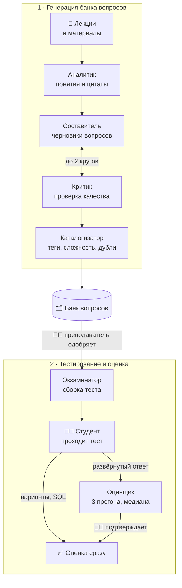

<div align="center">

# 🎓 Мультиагентная система генерации заданий и проверки развёрнутых ответов

**LLM-агенты по учебным материалам составляют банк контрольных вопросов,<br>собирают тесты и предварительно оценивают развёрнутые ответы студентов**

[](https://www.php.net/)
[](https://laravel.com/)
[](https://www.mysql.com/)
[](https://vitejs.dev/)
[](https://www.deepseek.com/)
[](backend/tests/Feature)

Выпускная квалификационная работа · ТюмГУ · «Информационные системы и технологии»

[Возможности](#-возможности) · [Как это работает](#-как-это-работает) · [Агенты](#-агенты) · [Запуск](#-быстрый-старт) · [Структура](#-структура-репозитория) · [Статус](#-статус-работы)

</div>

---

## 💡 Зачем

Сейчас контроль знаний в вузе устроен так: преподаватель вручную составляет и собирает тест в Moodle, задания годами повторяются, вся группа получает один вариант, а развёрнутые ответы проверяются долго и с разной строгостью. Студент вне аудитории видит только балл и не понимает, за что его получил.

Система берёт рутину на себя и оставляет решения за преподавателем:

| Проблема | Что делает система |
|---|---|
| 🔁 Задания повторяются из года в год | Агенты генерируют новые вопросы по загруженным лекциям |
| ⏳ Составление и сборка теста занимают много времени | Тест собирается из банка по матрице «тип × сложность» в один клик |
| 📋 Один вариант на всю группу | Вопросы и варианты ответов перемешиваются для каждого студента |
| ✍️ Ручная проверка развёрнутых ответов | Агент-оценщик даёт предварительную оценку по критериям, преподаватель подтверждает |
| ❓ Студент видит только балл | Разбор ответов с пояснениями, апелляция, работа над ошибками |

## ✨ Возможности

<table>
<tr>
<td width="50%" valign="top">

### 👩‍🏫 Преподаватель

- **Загрузка материалов** — PDF, DOCX, PPTX, ссылка или текст
- **Генерация вопросов агентами** в фоне, с журналом работы и расходом токенов
- **Банк вопросов** — фильтры, правка, одобрение, «выбрать без замечаний Критика»
- **Шесть типов вопросов** — один верный, несколько верных, верно/неверно, сопоставление, SQL-запрос, развёрнутый ответ
- **Сборка теста** по матрице «тип × сложность» из одобренных вопросов
- **Пробное прохождение** теста перед публикацией
- **Проверка развёрнутых ответов** — оценка агента, подсветка, уверенность, подтверждение
- **Аналитика** по тесту и экспорт в Excel, **экспорт банка в Moodle XML**

</td>
<td width="50%" valign="top">

### 🧑‍🎓 Студент

- **Мои тесты** — тесты своей группы и тренировки
- **Прохождение** с таймером по времени сервера и автосохранением
- **SQL-задания** на учебной базе прямо в браузере
- **Мгновенная оценка** вариантов и SQL, предварительная — развёрнутых ответов
- **Разбор** с пояснениями, когда пересдавать уже нельзя
- **Апелляция** по развёрнутому ответу
- **Работа над ошибками** — тренировка по неверным ответам
- **Личный кабинет** со сменой пароля

</td>
</tr>
</table>

## 🧩 Как это работает



Модель ничего не помнит между вызовами: общая память агентов — база MySQL (шаблон *blackboard*), а порядок работы задаёт код оркестратора `GenerationPipeline`. Каждый вызов модели записывается в журнал `llm_calls` (токены, время, версия промпта), из него считаются стоимость и время для экспериментальной главы.

## 🤖 Агенты

| Агент | Модель | Что делает |
|---|---|---|
| **Аналитик** | DeepSeek Flash | Режет материал на фрагменты, выделяет понятия, проверяет цитаты |
| **Составитель** | DeepSeek Flash | Пишет вопросы шести типов с эталоном, критериями и «исходными данными» |
| **Критик** | DeepSeek Pro | Формальные проверки до модели и проверка по смыслу; помечает спорные вопросы |
| **Каталогизатор** | DeepSeek Flash | Теги и сложность; похожесть ≥ 80 % — дубль, 45–80 % — решает модель |
| **Оценщик** | DeepSeek Pro | Три прогона, медиана баллов, уверенность по согласию прогонов, защита от «поставь максимум» |
| **Экзаменатор** | алгоритм | Сборка теста по матрице, пересчёт сложности вопроса по ответам |

Модель стоит только там, где без неё нельзя: Экзаменатор работает без LLM, а Критик и Оценщик используют более сильную модель, чем Составитель, чтобы не повторять его ошибок. Промпты лежат в [`backend/resources/prompts`](backend/resources/prompts), модели и пороги — в [`backend/config/agents.php`](backend/config/agents.php). Провайдер меняется через `.env`: клиент совместим с OpenAI API.

## 🛠 Технологии

| Слой | Что используется |
|---|---|
| Бэкенд | PHP 8.5, Laravel 13, очередь на базе данных |
| База | MySQL 8.4; учебная база для SQL-заданий — SQLite в памяти в отдельном процессе |
| Фронт | Blade + чистый JavaScript, сборка Vite |
| ИИ | DeepSeek через OpenAI-совместимый HTTP-клиент; драйвер-заготовка для тестов без сети |
| Окружение | OSPanel 6 (Apache 2.4) на Windows |
| Тесты | PHPUnit 12, 29 сквозных тестов на SQLite в памяти |

## 🚀 Быстрый старт

Проект запускается локально в [OSPanel 6](https://ospanel.io/). Подробная инструкция — в [`backend/README.md`](backend/README.md).

```bash
cd backend
composer install
npm install && npm run build
copy .env.example .env      # укажите доступ к MySQL и LLM_API_KEY
php artisan key:generate
php artisan migrate --seed  # учётки преподавателя и студента, курс «Базы данных»
```

Затем в OSPanel включите модули **MySQL-8.4**, **Apache** и **PHP-8.5** и откройте http://ptp.localhost.

Без ключа нейросети система тоже работает: с `AGENTS_DRIVER=fake` агенты отвечают шаблонами. Так устроены автотесты:

```bash
php artisan test
```

## 🔒 Безопасность

- Роли преподавателя и студента, вход по сессии, CSRF-защита с проверкой источника запроса, ограничение частоты входа.
- Студент видит только тесты своей группы. Правильные ответы не раскрываются ни в разборе, ни в тренировке, пока их можно использовать в идущем тесте.
- Запрос студента к учебной базе выполняется в отдельном процессе с таймаутом 3 секунды и пределом памяти: «бесконечный» запрос не повесит сайт.
- Оценщик распознаёт попытки «уговорить» модель, итог по развёрнутым ответам подтверждает преподаватель.
- Ключ нейросети хранится только в `.env`. В модель уходит только текст ответа, без ФИО и группы.

## 📁 Структура репозитория

```
├── backend/                 Laravel-приложение: экраны, API, агенты, тесты
│   ├── app/Agents/          агенты: интерфейсы, реализации на LLM и заготовки
│   ├── app/Services/        конвейер агентов, оценка, попытки, учебная база SQL
│   ├── resources/prompts/   промпты агентов с версиями
│   ├── resources/views/     экраны преподавателя и студента
│   └── tests/Feature/       сквозные тесты и тесты безопасности
├── frontend/                кликабельный прототип 12 экранов на HTML/CSS/JS
└── архитектура/             проект ИИ-части и разбор требований научного руководителя
```

## 📌 Статус работы

- [x] Анализ предметной области и обзор 20 аналогов
- [x] Модель процесса AS-IS (BPMN, SIPOC)
- [x] Прототип интерфейса из 12 экранов
- [x] Бэкенд с ролями, банком вопросов, тестами и аналитикой
- [x] ИИ-агенты на DeepSeek, проверены на лекции по нормализации
- [x] Проверка безопасности и исправления
- [ ] Модель TO-BE и функциональные требования
- [ ] Уровневое тестирование по схеме научного руководителя (три уровня, шкалы по попыткам)
- [ ] Типы вопросов «пропуски» и «последовательность»
- [ ] Экспериментальная глава: точность Оценщика и качество генерации

## 👥 Авторы

| | |
|---|---|
| **Маланыч Иван Геннадьевич** | студент, автор проекта |
| **Зиганшин Михаил Иванович** | студент, соавтор |
| **Бакановская Людмила Николаевна** | научный руководитель |

Тюменский государственный университет, направление «Информационные системы и технологии».
